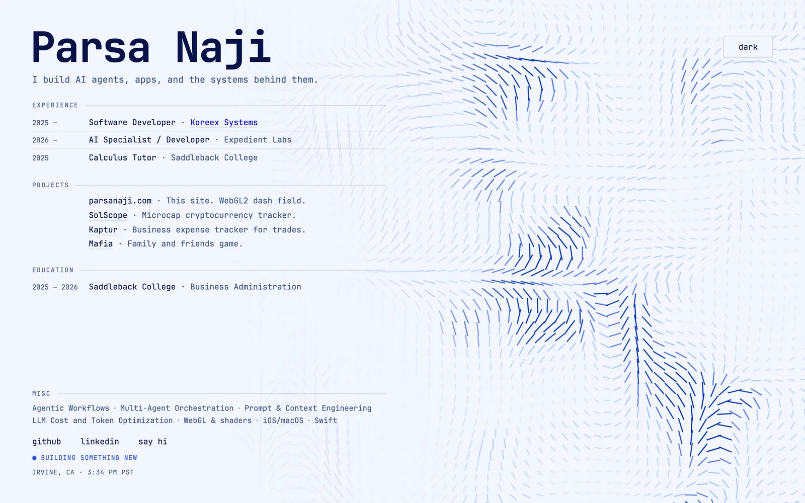

# parsanaji.com

My personal site. One screen: a short résumé on the left, a live WebGL2 field of flowing dashes behind it.

**Live: [parsanaji.com](https://parsanaji.com)**

<picture>
  <source media="(prefers-color-scheme: dark)" srcset="docs/screenshots/dark.webp">
  
</picture>

## How it works

- **Raw WebGL2, two passes.** Pass 1 draws a fullscreen triangle into a small texture with one texel per lattice cell. Noise, pointer repel, click ripples and the name mask all land there. Pass 2 draws every dash as an instanced quad that reads its cell for length, opacity and colour. Two draw calls a frame, no framework, no three.js.
- **The name forms on load.** The dashes gather into "Parsa Naji", hold, then let go as the résumé fades in. On phones the name stacks onto two lines.
- **The shader math has a CPU twin.** [`src/field/surface.ts`](src/field/surface.ts) mirrors the GLSL in plain TypeScript. Unit tests pin it, and [`scripts/og-image.mjs`](scripts/og-image.mjs) uses it to draw the share image and favicons, so they match the live field.
- **Light and dark.** Follows the OS, the toggle remembers your pick, and a tiny blocking script sets the theme before first paint, so there's no flash.
- **Small.** Under 20 kB of gzipped JS, two self-hosted JetBrains Mono subsets (about 12 kB each), no runtime dependencies, and a strict Content-Security-Policy.
- **Easy on devices.** Reduced motion gets a still field. The loop pauses in background tabs, survives a lost WebGL context, and lowers quality when frames run slow.

There are a few keyboard extras too. Press `?` on the site.

## Run it

Needs Node 22.18 or newer.

```bash
npm install
npm run dev        # http://localhost:5173, add ?debug for the tuning panel
npm test           # Vitest
npm run build      # type-check, then build to dist/
```

## Layout

```
src/
  main.ts        boot order: theme, résumé modules, then the field
  app.ts         per-frame wiring: pointer, ripples, entry, renderer
  field/         flow, sizing, pointer, ripples, name mask, surface.ts (the CPU twin)
  gl/            WebGL2 context, async shader compile, render targets
  shaders/       surface pass and dash pass (GLSL ES 3.0)
  theme/  ui/    theme toggle, clock, links, copy-email button
  eggs/          keyboard shortcuts and other extras
scripts/         share image, font subsetting, Cloudflare setup
tests/           Vitest suites
docs/design/     design specs (code comments like "spec 3.3.7" point here)
```

## Deploy

GitHub Actions runs on every push: tests, build, then `wrangler pages deploy` to Cloudflare Pages ([`deploy.yml`](.github/workflows/deploy.yml)). `main` goes to parsanaji.com. Any other branch gets a preview at `https://<branch>.parsanaji-com.pages.dev`, built with the `?debug` panel on.

The workflow needs two repository secrets: `CLOUDFLARE_API_TOKEN` (Account › Cloudflare Pages › Edit is enough) and `CLOUDFLARE_ACCOUNT_ID`.

To deploy from a terminal, copy `.env.example` to `.env`, fill it in, then run `npm run deploy` (production) or `npm run deploy:preview`.

One-time Cloudflare setup lives in `scripts/`. Each script reads `.env` and is safe to rerun:

```bash
node scripts/cf-env.mjs           # check the token, record the account and zone IDs
node scripts/cf-setup-pages.mjs   # custom domain, DNS, www redirect, HTTPS
node scripts/cf-setup-email.mjs   # forward info@ to EMAIL_ROUTING_DEST
npm run fonts                     # rebuild the font subsets
npm run og                        # rebuild og.png and the favicons
```

<details>
<summary>Token permissions for the setup scripts</summary>

- Account › Cloudflare Pages › Edit
- Account › Email Routing Addresses › Edit
- Account › Account Settings › Read
- Zone › Zone › Read
- Zone › DNS › Edit
- Zone › Zone Settings › Edit
- Zone › Email Routing Rules › Edit
- Zone › Single Redirect › Edit

Scope the zone permissions to the one domain. CI only needs the Pages permission, so give it a separate, narrower token.

</details>

## License

© 2026 Parsa Naji. The source is public so you can read it and learn from it. It isn't licensed for reuse, and neither are my name, résumé text or images.

JetBrains Mono is used under the [SIL Open Font License 1.1](scripts/fonts-src/OFL.txt).
